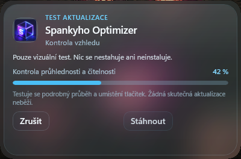

# Glass Optimizer

Glass Optimizer is a Windows optimizer with a compact glass interface and conservative, reversible automation.

## Verified release

[Glass Optimizer 16.322.0](https://github.com/Spankycze/Glass-Optimizer/releases/tag/v16.322.0)

The release contains only the verified compact installer, its SHA-256 checksum, and the changelog. Source code is not included.

## Supported fan hardware

The Ventilátory section appears and operates only when the supported Lian Li UNI FAN SL-Infinity USB controller is detected (`0CF2:A102`). Actions recheck hardware support before changes.

## Screenshots

### Main window

### Compact popup

## Compatibility

Legacy internal installation, process, task, and registry identifiers remain unchanged for upgrade compatibility.
