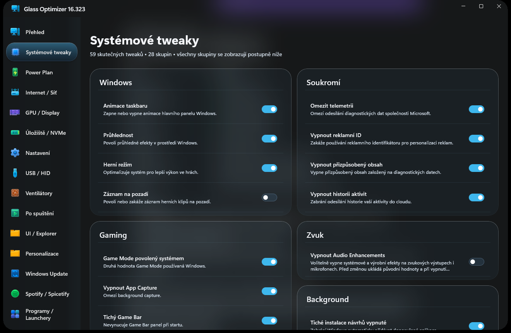
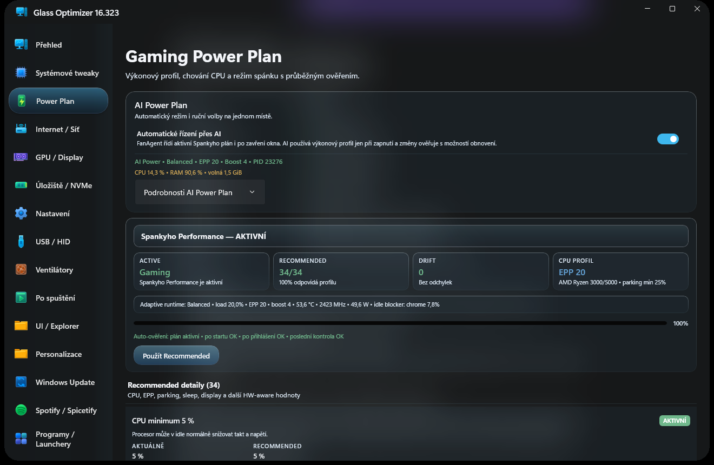
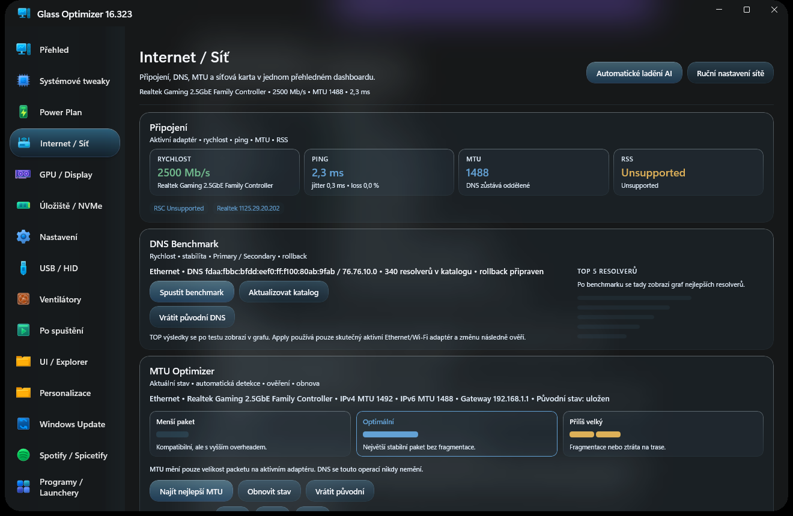
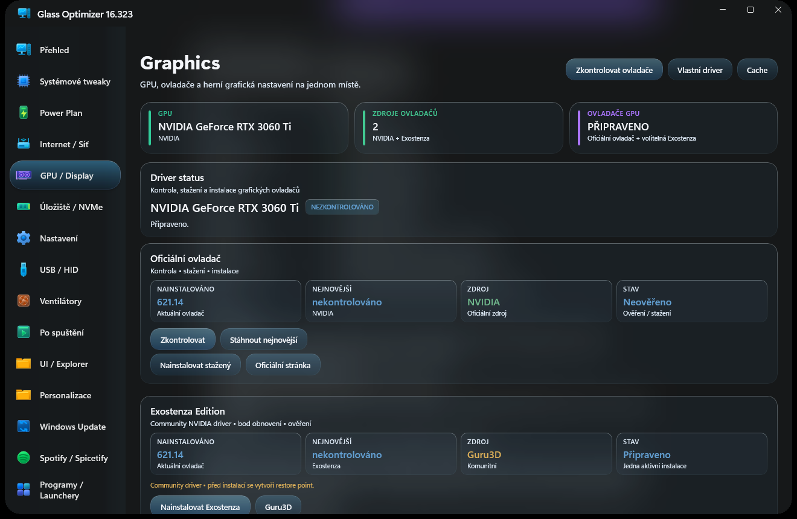
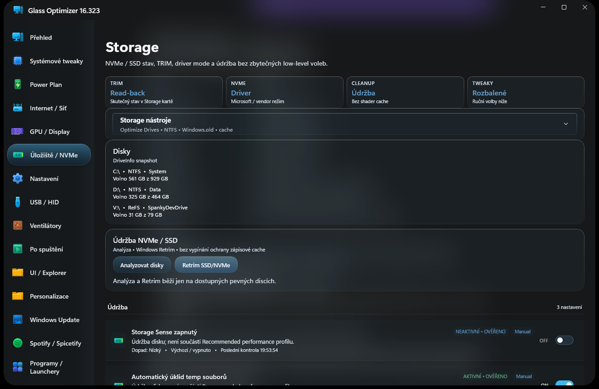
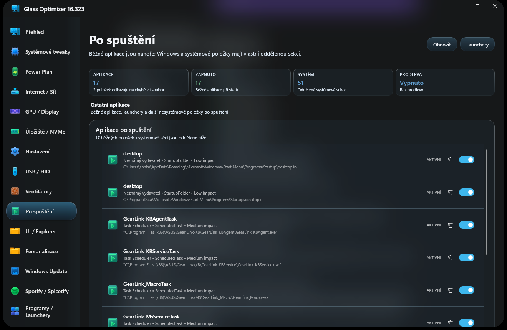
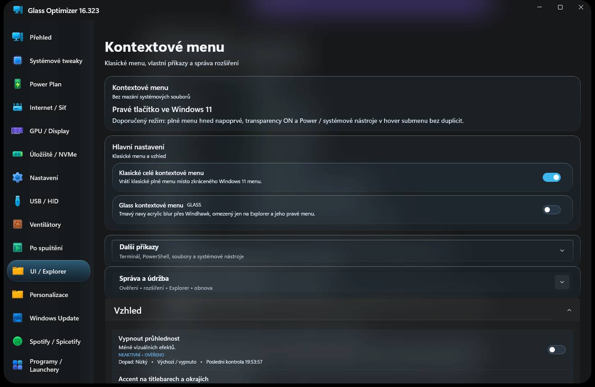
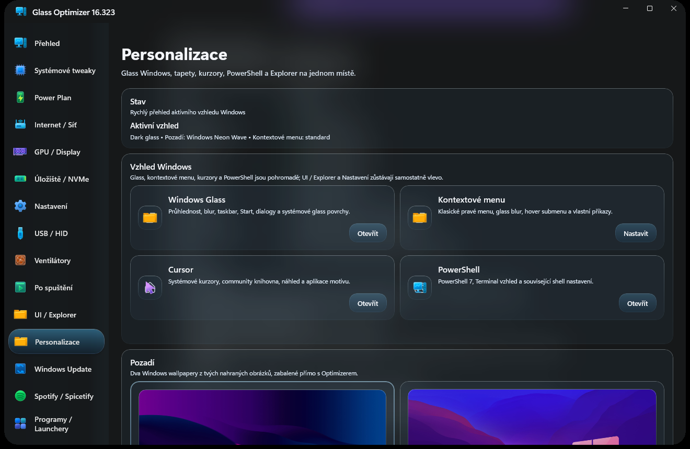

# Glass Optimizer

Glass Optimizer spravuje vybrané funkce Windows, napájení, systémové nastavení, síť, úložiště, GPU a místní AI Runtime.

## Ověřené vydání

[Glass Optimizer 16.333.0](https://github.com/Spankycze/Glass-Optimizer/releases/tag/v16.333.0)

Vydání obsahuje kompaktní instalátor, SHA-256 kontrolní součet a changelog.

## Hlavní funkce

- Přehled a systémové tweaky Windows.
- Power Plan a vybrané parametry napájení.
- GPU, Display, úložiště NVMe a USB/HID.
- Po spuštění, UI/Explorer a personalizace.
- Síť, Windows Update, Spotify/Spicetify a podporované launchery.
- Defender, Fixer a Debloater.
- AI System Runtime pro místní automatizaci podporovaných systémových úloh.
- Témata `Glass` a `Solid Dark`.
- Updater s ověřením oficiálního GitHub vydání.

### Ventilátory

Sekce Ventilátory se zobrazí a funguje pouze při detekci podporovaného řadiče Lian Li UNI FAN SL-Infinity USB (`0CF2:A102`). Aplikace hardware ověří také před změnou RPM, PWM, RGB nebo AI profilu.

## Snímky aplikace

## Kompatibilita

Některé interní názvy instalace, procesu, naplánovaných úloh a registru zůstávají kvůli aktualizacím zachované.
