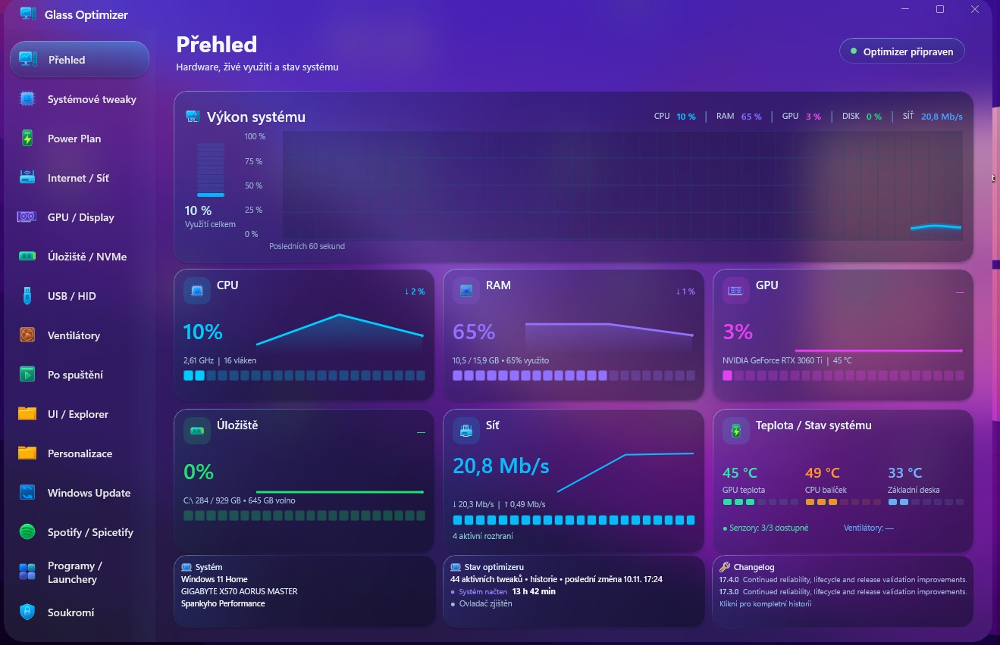

# Glass Optimizer

  

  <strong>A focused Windows control center for system tuning, maintenance, power management and local automation.</strong>

  
  
  

Glass Optimizer brings frequently used Windows controls into one compact desktop application. It combines a glass-style interface with guarded system changes, read-back checks and reversible operations where Windows allows them.

## Verified release

[Download Glass Optimizer 17.4.0](https://github.com/Spankycze/Glass-Optimizer/releases/tag/v17.4.0)

The release provides the verified Compact installer, its SHA-256 checksum and the release changelog. The application can check official GitHub releases in the background approximately every five hours. Downloaded installers are verified before the existing elevated installation flow starts.

## What it includes

### Windows controls

- **Overview:** a single starting point for system status and the main application areas.
- **System tweaks:** grouped Windows system, privacy and user-interface settings.
- **Power Plan:** available plans and selected power parameters, including protected AC `Never` values.
- **GPU and Display:** graphics and display-related controls.
- **Storage and NVMe:** storage information and maintenance tools.
- **USB and HID:** connected USB and input-device information.
- **Startup:** supported registry, startup-folder and third-party scheduled-task entries.
- **UI and Explorer:** supported Windows shell and Explorer settings.
- **Personalization:** available appearance and personalization controls.

### Network and applications

- **Internet and Network:** network information and supported network tools.
- **Windows Update:** update status and supported repair controls.
- **Spotify and Spicetify:** available Spotify and Spicetify tools.
- **Apps and Launchers:** supported applications and game-launcher entries.

### Maintenance and protection

- **Privacy:** supported Windows privacy settings.
- **Microsoft Defender:** available Defender information and controls.
- **AI Debloater and Debloater:** guarded management of selected Windows components.
- **Fixer:** supported Windows repair actions with confirmation before mutation.
- **Settings:** application language, theme and preference controls.

### Local automation and fan control

- **AI System Runtime:** local automation for selected power-plan behavior, CPU process priorities, GPU game priorities, supported services and scheduled tasks.
- **AI Smart Runtime:** local fan telemetry analysis using temperature, power, load and RPM data; no cloud processing is required.
- **Fan control:** available only when the supported Lian Li UNI FAN SL-Infinity USB controller `0CF2:A102` is detected. Hardware is checked again before RPM, PWM, RGB or AI-profile changes.

## Safety model

- Mutating actions use confirmation, validation and read-back where supported.
- Power-plan guard values protect the four requested AC `Never` settings.
- Automatic behavior is local, bounded and controlled by application safety rules.
- The updater verifies official release data and installer SHA-256 before installation.
- Internal installer, process, task and registry identifiers remain stable for upgrade compatibility.

## Compatibility

Glass Optimizer targets supported Windows desktop environments. Some internal installer, process, scheduled-task and registry names remain unchanged for upgrade compatibility.

## License and release notes

See the [17.4.0 release](https://github.com/Spankycze/Glass-Optimizer/releases/tag/v17.4.0) for the verified installer and checksum. See [`CHANGELOG.md`](CHANGELOG.md) for the English release history.
