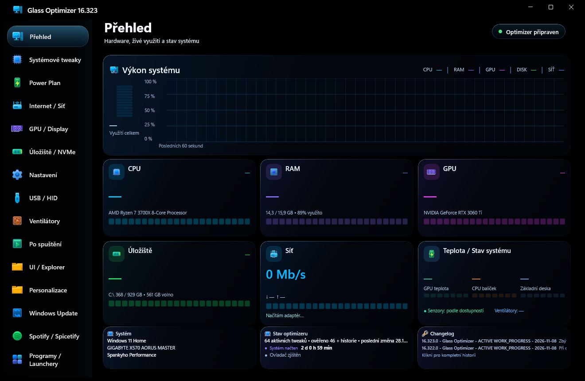
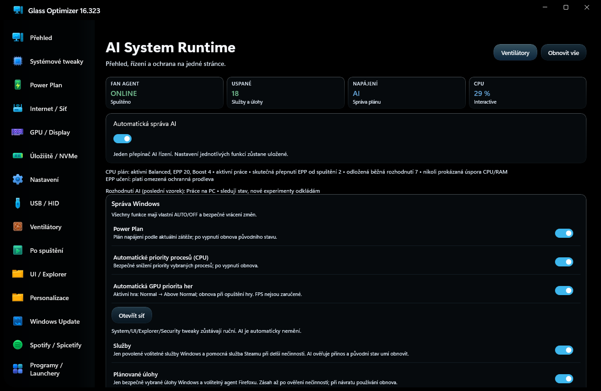
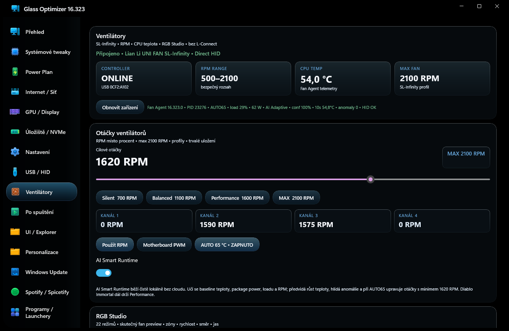

# Glass Optimizer

Glass Optimizer je nástroj pro správu, úpravy a automatizaci vybraných funkcí Windows. Nabízí přehledné rozhraní, bezpečnostní kontroly a vratné změny tam, kde je lze obnovit.

## Ověřené vydání

[Glass Optimizer 16.323.0](https://github.com/Spankycze/Glass-Optimizer/releases/tag/v16.323.0)

Vydání obsahuje pouze ověřený kompaktní instalátor, jeho kontrolní součet SHA-256 a changelog. Zdrojový kód součástí vydání není.

## Funkce

### Systém a výkon

- **Přehled:** vstupní obrazovka se stavem a odkazy na hlavní části aplikace.
- **Systémové tweaky:** nastavení systému a soukromí uspořádaná do kategorií.
- **Power Plan:** správa dostupných plánů napájení a jejich vybraných parametrů.
- **GPU / Display:** nástroje pro nastavení grafiky a zobrazení.
- **Úložiště / NVMe:** přehled a dostupné nástroje pro úložiště.
- **USB / HID:** přehled připojených USB zařízení a zařízení pro vstup.
- **Po spuštění:** správa podporovaných položek spouštěných po přihlášení.
- **UI / Explorer:** nastavení uživatelského rozhraní Windows a Průzkumníka.
- **Personalizace:** dostupné možnosti přizpůsobení Windows.

### Síť a aplikace

- **Internet / Síť:** přehled síťových informací a dostupných síťových nástrojů.
- **Windows Update:** zobrazení stavu a dostupných ovládacích prvků aktualizací.
- **Spotify / Spicetify:** dostupné úpravy a nástroje pro Spotify a Spicetify.
- **Programy / Launchery:** přehled podporovaných programů a herních launcherů.

### Údržba a ochrana

- **Nastavení:** nastavení a předvolby aplikace.
- **Soukromí:** dostupná nastavení soukromí Windows.
- **Defender:** přístup k dostupným informacím a ovládacím prvkům Microsoft Defenderu.
- **AI Debloater:** asistované nástroje pro správu vybraných součástí Windows. Před potvrzením změn zkontrolujte jejich dopad.
- **Debloater:** další dostupné nástroje pro správu předinstalovaných součástí.
- **Fixer:** nástroje pro diagnostiku a opravu podporovaných problémů Windows.

### AI a ventilátory

- **AI System Runtime:** místní automatizace pro vybrané chování plánu napájení, priority procesů CPU a her GPU, a správu podporovaných služeb či naplánovaných úloh. Ovládací prvky lze zapnout nebo vypnout; změny jsou omezeny bezpečnostními pravidly aplikace.
- **Ventilátory:** sekce se zobrazí a funguje pouze při detekci podporovaného řadiče Lian Li UNI FAN SL-Infinity USB `0CF2:A102`. Aplikace před změnou znovu ověřuje podporovaný hardware.
- **AI Smart Runtime:** místní analýza telemetrie ventilátorů používá teplotu, příkon, zatížení a otáčky k odhadu vývoje teploty, sledování odchylek a řízení podporovaného chování ventilátorů. Nepotřebuje cloudové zpracování.

## Snímky aplikace

### Přehled a ovládání ventilátorů

### AI System Runtime

### Podporované ventilátory

## Kompatibilita

Některé interní názvy instalace, procesu, naplánovaných úloh a registru zůstávají zachovány kvůli kompatibilitě při aktualizaci.
